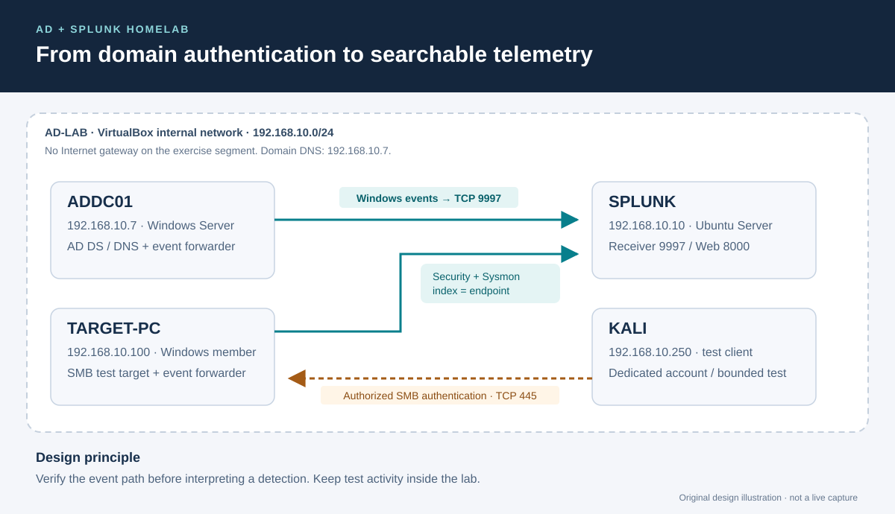

# AD + Splunk Homelab

An isolated Windows domain lab for learning how authentication activity reaches Splunk and how to investigate suspicious network logons.

**Documentation maintainer:** Jayanth K · **Updated:** 15 October 2026

This repository provides a build guide, configuration examples and an investigation workflow. It does not contain personal live-lab execution records or captured screenshots. The diagrams describe the design; they are not console captures.



[Open full-size architecture diagram](assets/diagrams/lab-architecture.svg) · [Read the design](docs/architecture.md)

## Start here

| Task | Document |
|---|---|
| Understand the four-machine design | [Architecture and boundaries](docs/architecture.md) |
| Build the domain and collector | [Setup runbook](docs/setup.md) |
| Configure and check Windows forwarding | [Telemetry pipeline](docs/telemetry.md) |
| Investigate repeated network logon failures | [SMB authentication case](cases/SMB-BruteForce-Detection/README.md) |
| Test the documentation locally | [Validation guide](docs/validation.md) |
| Resolve common ingestion problems | [Troubleshooting](docs/troubleshooting.md) |
| Review technical sources and inspiration | [References](docs/REFERENCES.md) |

## What the lab is designed to teach

- Separate identity services, endpoint telemetry and the analysis platform.
- Follow an event from the Windows Security log to a searchable Splunk record.
- Use source, account, target host and time together when investigating authentication.
- Distinguish a detection candidate from a supported investigation conclusion.
- Keep evidence capture reproducible without publishing credentials or unnecessary personal information.

## Repository map

```text
AD-Splunk-Homelab/
├── assets/diagrams/                 Editable SVG design illustrations
├── cases/SMB-BruteForce-Detection/   Investigation plan and evidence requirements
├── configs/splunk/                  Lab forwarding examples
├── detections/                     SPL searches and field assumptions
├── docs/                           Architecture, setup, validation and sources
├── scripts/                        Offline repository checker
├── AGENTS.md                       Agent entry point
├── agent.md                        Editing and publication instructions
└── Bible.md                        Project decisions and verification boundaries
```

## Operating boundaries

Use machines and accounts you control. Keep the exercise off bridged networks and never expose SMB, domain services or the Splunk receiver to the Internet. Use separate lab credentials, snapshots and a controlled test account. The setup is a learning design, not a production security baseline.

The included SPL is a starting point for XML-rendered Windows events. Validate field extraction, volume and thresholds in your own environment before enabling an alert. A successful local documentation check does not establish that these searches ran in Splunk.
