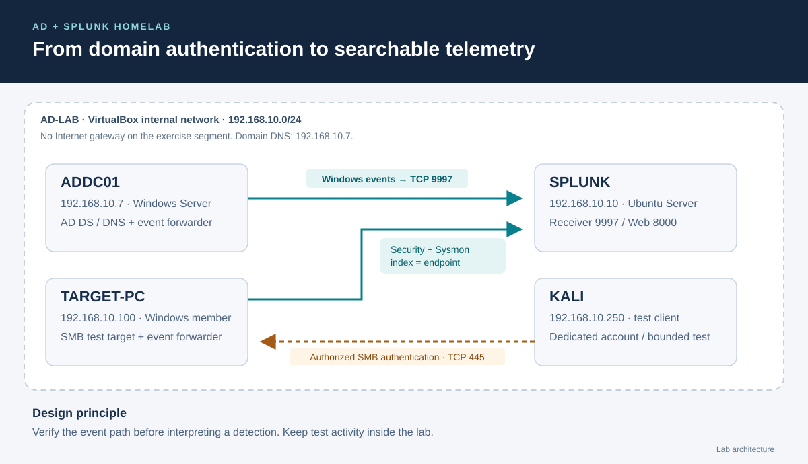

# Active Directory + Splunk Homelab

A four-machine lab for collecting Windows events in Splunk and investigating repeated authentication failures.

**Documentation:** Jayanth K · **Updated:** 15 October 2026

## Explore the project

- [Build the lab](SETUP.md) — network, Active Directory, Splunk and event forwarding.
- [SMB investigation](SMB-Investigation.md) — procedure, searches and screenshots.
- [Configuration examples](configs/) · [Splunk searches](searches/)

## Lab layout



| Machine | Address | Role |
|---|---|---|
| ADDC01 | 192.168.10.7 | Active Directory, DNS and event forwarding |
| TARGET-PC | 192.168.10.100 | Domain workstation and SMB test share |
| SPLUNK | 192.168.10.10 | Event collection and analysis |
| KALI | 192.168.10.250 | Authorized test client |

The VMs share an isolated VirtualBox internal network, `AD-LAB`. The domain is `ad.lab.test`; Windows events go to the `endpoint` index on TCP 9997.

## Files

```text
AD-Splunk-Homelab/
├── README.md
├── SETUP.md
├── SMB-Investigation.md
├── configs/                 Forwarder input and output examples
├── searches/                Three authentication searches
└── images/                  Architecture and two Splunk screenshots
```

## Credits and documentation status

The lab topic and two unchanged Splunk screenshots come from [Vikram2003-07/HomeLab](https://github.com/Vikram2003-07/HomeLab/tree/244b1409225db2a2748681e3493db48dc845f7a9), reused with permission confirmed by this repository's maintainer. Credit for those source captures and the source investigation belongs to their creator. Jayanth K maintains this repository's independently written guide, configuration examples and searches.

Documentation and presentation updates are complete. Personal execution of this guide and its SPL searches has not been verified. The screenshots show the source lab's `jsmith` account, not this guide's `LAB\labuser`; their original dates and values are preserved. The architecture is a design diagram, not an execution capture.

Use the lab only on machines and accounts you control. Configuration examples are for an isolated learning environment, not a production security baseline.
