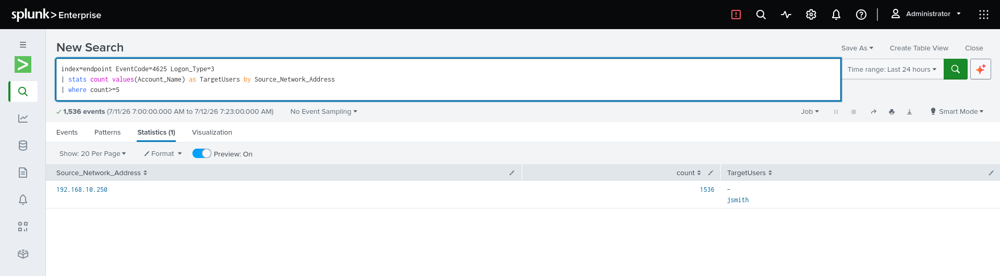

# SMB Authentication Investigation

[Home](README.md) · [Lab setup](SETUP.md)

## Objective

Trace repeated network logon failures from a controlled SMB test into Splunk, identify the client and account, and correlate any subsequent successful logon. Case ID: `AD-SMB-001`.

## Screenshots



The displayed search filters EventCode `4625` and Logon Type `3`, groups by source address and returns 1,536 events for `192.168.10.250`, with `jsmith` among the account values. [View full size](images/splunk-search.png).


This separate search view contains 3,480 events; its EventCode summary lists `4625` with a count of 1,339. The screenshots use different searches and must not be treated as matching totals. [View full size](images/event4625.png).

## Controlled test

Use only the isolated lab, with a snapshot and recovery path. Confirm the account's effective lockout policy, target permissions, audit coverage and time synchronization first.

1. Connect from Kali to the approved `LabShare` on `TARGET-PC` using `LAB\labuser`.
2. Verify one ordinary successful authentication locally and in Splunk.
3. If lockout policy permits, make a small, manually bounded set of incorrect-password attempts. Stop at the planned limit or on lockout or unexpected activity.
4. If the account remains usable, make one authorized successful attempt. Enter passwords interactively rather than in command history.
5. Record the command, result, host, client, start/end time with timezone and matching raw Windows events.

```bash
smbclient //192.168.10.100/LabShare -p 445 -U 'LAB\labuser'
```

After connecting, use `ls` to inspect the harmless share and `quit` to exit. Do not use password lists, broad scans or automated retries for this exercise.

## Splunk searches

| Search | Purpose |
|---|---|
| [Authentication overview](searches/authentication-overview.spl) | Inspect 4624/4625 events and extracted identity, client and host fields |
| [Network failure burst](searches/network-failure-burst.spl) | Find at least three failures per host/client/account in a fixed five-minute bucket |
| [Success after failures](searches/success-after-failures.spl) | Find a success preceded by at least three failures in a rolling ten-minute window |

The searches use `index=endpoint` and extract fields from XML-rendered Windows Security events. Check raw `EventID` and named `Data` elements, missing fields, namespaces and XML-encoded names. Adapt to reliable add-on fields where appropriate. Splunk's `host` identifies the Windows log source; it is not the remote client IP.

Choose thresholds that respect lockout policy and baseline. Attempts split across fixed five-minute bucket boundaries may be missed. Keep time ranges narrow for the sorted ten-minute correlation and inspect events with identical timestamps. The screenshot query uses existing extracted fields and a different threshold from these files.

## Interpretation

Event `4625` is a failed logon; `4624` is a successful logon. Type `3` establishes a network logon, not SMB by itself. Match client, target, account and time with the approved command and TCP `445` context before making an SMB-specific conclusion.

Review status/substatus, authentication package, stale credentials and other activity sharing the source/account pair. Success after failures does not by itself prove password guessing, compromise or file access. See [Microsoft's Event 4625 field guide](https://learn.microsoft.com/en-us/windows/security/threat-protection/auditing/event-4625).

## Evidence and closure

Collect audit/lockout settings, client output, raw Security exports, exact query and time picker, results and protocol context. Match provider, event ID, record ID, host and UTC creation time between Windows and Splunk. Record parser misses and false positives.

For each reviewed artifact, retain a relative filename, source host/tool, capture time with timezone, description and SHA-256. Preserve private originals; hash published bytes after documented redaction. Exclude passwords, tokens and unrelated personal data.

```powershell
Get-FileHash -LiteralPath '.\capture.png' -Algorithm SHA256
```

Write a conclusion tied to those artifacts, including alternatives and confidence. Account restriction, source blocking or host isolation require the environment's response authority and an action record before being described as completed.
