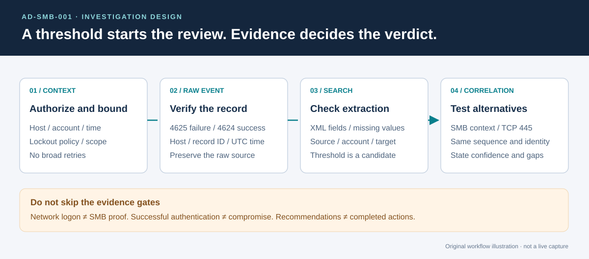

# SMB Authentication: Failure-to-Success Triage

[Home](../../README.md) · [Investigation plan](reports/investigation-plan.md) · [Evidence requirements](evidence/README.md)

**Case ID:** AD-SMB-001 · **Environment:** isolated lab · **Status:** investigation design; no execution capture included.

## Question

Can the lab detect repeated network logon failures, identify the account and client involved, and determine whether a later successful logon belongs to the same authorized SMB test?

The folder retains a familiar topic name for navigation. The actual detection is broader than SMB until network or test context establishes the protocol. An alert candidate is not an automatic malicious verdict.

*Original workflow illustration, not a captured investigation.* [Open full-size workflow](../../assets/diagrams/investigation-flow.svg).

## Read in order

1. Verify [ingestion and the field contract](../../docs/telemetry.md).
2. Review the [scope and controlled procedure](reports/investigation-plan.md).
3. Run the appropriate [searches](../../detections/README.md) in your own lab.
4. Capture the [required artifacts](evidence/README.md) before writing a verdict.

There are no borrowed execution images, invented timestamps or synthetic log outputs in this case. Add genuine artifacts from the authorized run, with capture context and hashes, when they are available.
