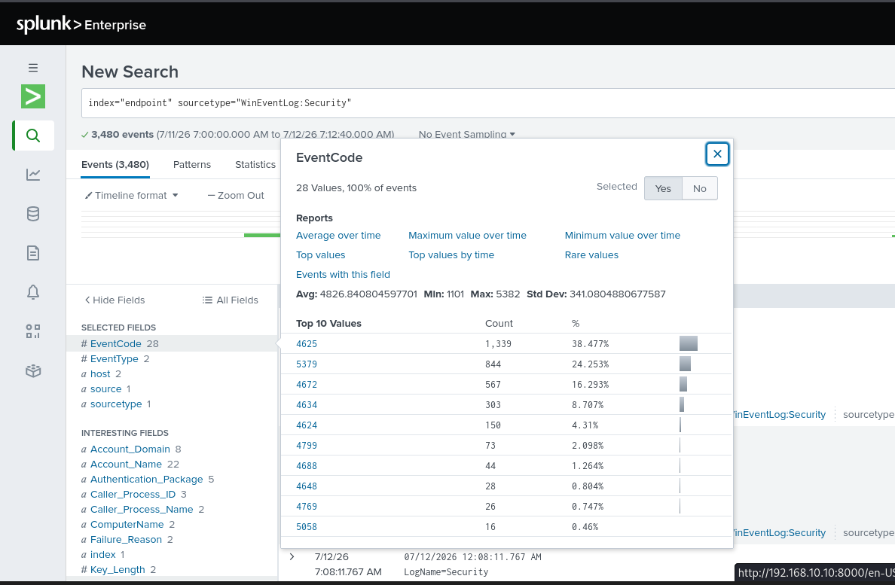

# SMB Authentication: Failure-to-Success Triage

[Home](../../README.md) · [Investigation plan](reports/investigation-plan.md) · [Evidence requirements](evidence/README.md)

**Case ID:** AD-SMB-001 · **Environment:** isolated lab · **Status:** investigation guide with authorized reference captures; local execution not verified.

## Question

Can the lab detect repeated network logon failures, identify the account and client involved, and determine whether a later successful logon belongs to the same authorized SMB test?

The folder retains a familiar topic name for navigation. The actual detection is broader than SMB until network or test context establishes the protocol. An alert candidate is not an automatic malicious verdict.

## Authorized reference captures

The following screenshots are reproduced unchanged with permission confirmed by the repository maintainer, from [Vikram2003-07/HomeLab](https://github.com/Vikram2003-07/HomeLab/tree/244b1409225db2a2748681e3493db48dc845f7a9/SMB-BruteForce-Detection). They show the source environment, not an execution of this guide. Account names, timestamps, queries and results are preserved. The source account `jsmith` is different from this guide's proposed `LAB\labuser` identity.

*Reference capture: the visible search filters EventCode 4625 and Logon Type 3, groups by source address and shows a count of 1,536 for `192.168.10.250`, with `jsmith` among the displayed account values. This is not a result from the included SPL files.* [Open original-size capture](images/splunk-search.png).

*Reference capture: the EventCode distribution lists 4625 with a count of 1,339 within a 3,480-event search. This is a separate search view; its count should not be treated as interchangeable with the first capture.* [Open original-size capture](images/event4625.png).

## Read in order

1. Verify [ingestion and the field contract](../../docs/telemetry.md).
2. Review the [scope and controlled procedure](reports/investigation-plan.md).
3. Run the appropriate [searches](../../detections/README.md) in your own lab.
4. Capture the [required artifacts](evidence/README.md) before writing a verdict.

The reference captures do not establish a completed local run, successful compromise or containment. Add artifacts from your own authorized run, with capture context and hashes, before asserting those outcomes.
